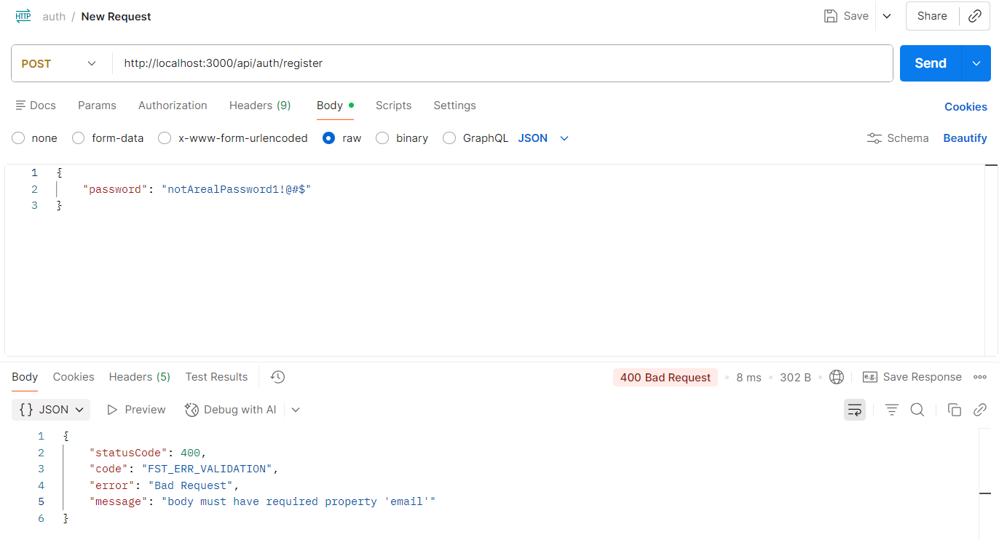
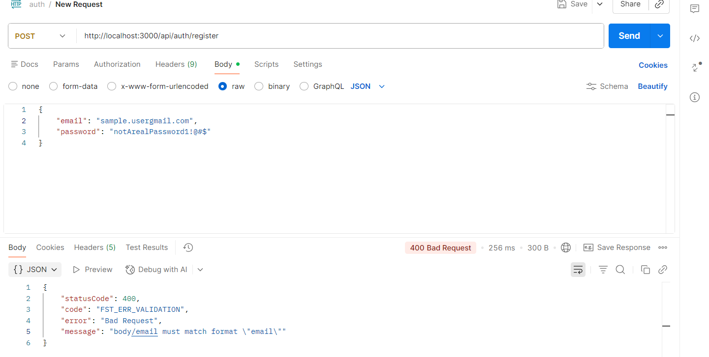
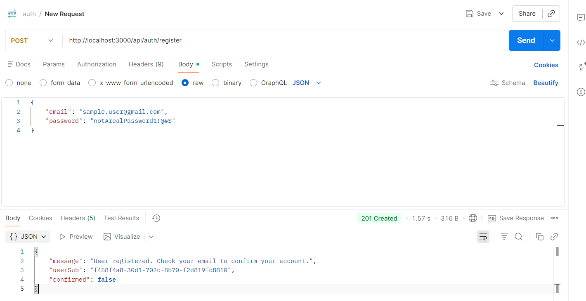
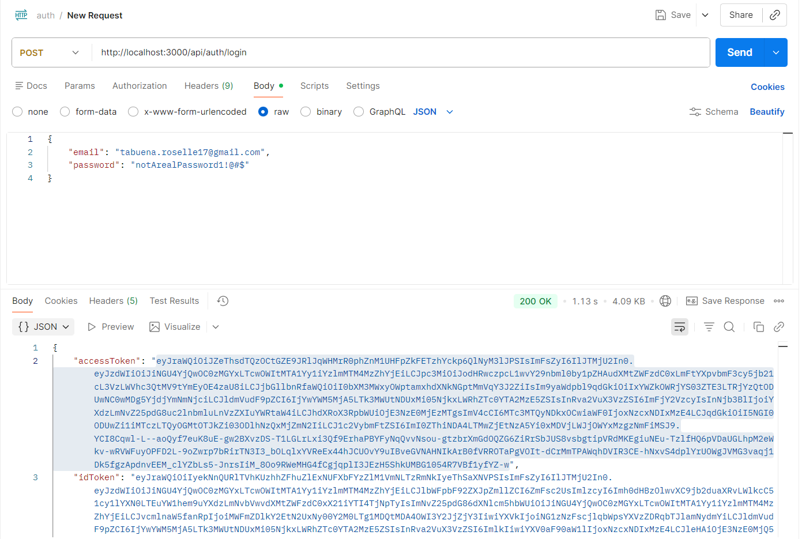
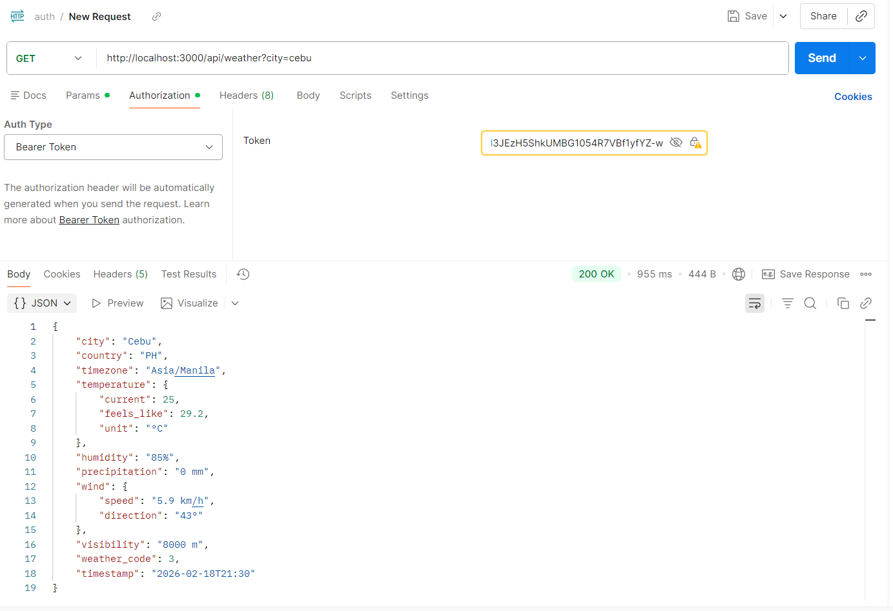
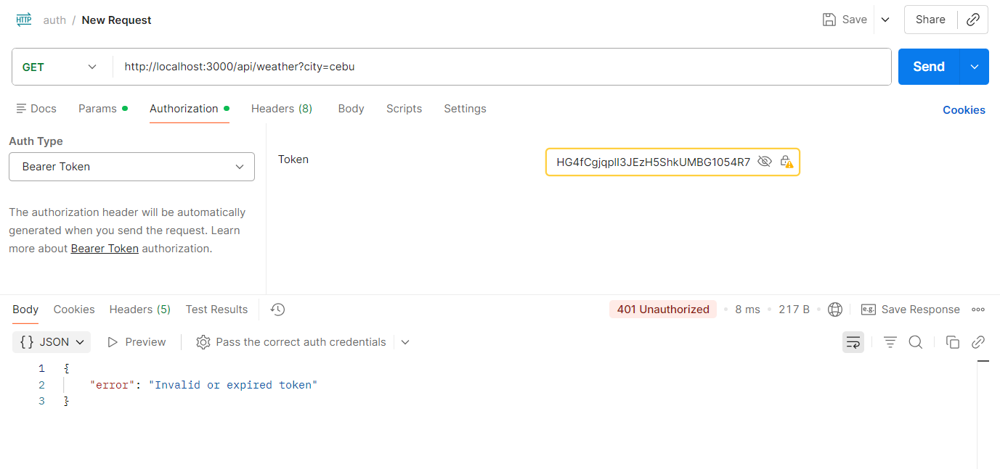

# Backend Technical Assessment

A RESTful API backend built with **TypeScript** and **Fastify**, leveraging **AWS** services for authentication and serverless deployment.

---

## Tech Stack

| Layer          | Technology           |
| -------------- | -------------------- |
| Runtime        | Node.js + TypeScript |
| Framework      | Fastify              |
| Authentication | AWS Cognito          |
| Serverless     | AWS Lambda           |
| API Management | AWS API Gateway      |

---

## Project Structure

```
BACKEND/
├── screenshots/
│   ├── login.png
│   ├── register.png
│   ├── weather-failed.png
│   └── weather-success.png
├── src/
├── .env
├── .gitignore
├── package.json
├── package-lock.json
├── tsconfig.json
└── README.md
```

> **Note:** An `infra/` folder exists in the full project (containing infrastructure-as-code configurations, e.g., AWS CDK/SAM/Serverless Framework definitions) but is not included in this repository submission.

---

## API Routes

### POST `/api/auth/register`

Registers a new user via AWS Cognito.

**Request Body:**

```json
{
  "email": "user@example.com",
  "password": "YourPassword123!"
}
```

**Response:**

```json
{
  "message": "User registered. Check your email to confirm your account.",
  "userSub": "4458e488-*",
  "confirmed": false
}
```

---

### POST `/api/auth/login`

Authenticates an existing user and returns JWT tokens from Cognito.

**Request Body:**

```json
{
  "email": "user@example.com",
  "password": "YourPassword123!"
}
```

**Response:**

```json
{
  "accessToken": "eyJ...",
  "idToken": "eyJ...",
  "refreshToken": "eyJ...",
  "expiresIn": ""
}
```

---

### GET `/api/weather`

Returns weather data. **Protected route** — requires a valid Cognito `accessToken` in the Authorization header.

**Headers:**

```
Authorization: Bearer <accessToken>
```

**Response (Success):**

```json
{
  "city": "Manila",
  "country": "PH",
  "timezone": "Asia/Manila",
  "temperature": {
    "current": 26.6,
    "feels_like": 29.7,
    "unit": "°C"
  },
  "humidity": "70%",
  "precipitation": "0 mm",
  "wind": {
    "speed": "8 km/h",
    "direction": "8°"
  },
  "visibility": "24140 m",
  "weather_code": 1,
  "timestamp": "2026-02-18T23:00"
}
```

**Response (Unauthorized):**

```json
{
  "error": "Invalid or expired token"
}
```

---

## Request Validation

Auth routes include JSON Schema validation powered by Fastify's built-in validation support. Requests that fail validation are rejected before reaching the handler, returning a `400 Bad Request` with a descriptive error message.

**`POST /api/auth/register`** enforces:

- `email` — required, must be a valid email format
- `password` — required, minimum 8 characters

**`POST /api/auth/login`** enforces:

- `email` — required, must be a valid email format
- `password` — required

### Validation – Missing Email Property



### Validation – Wrong Email Format



---

## Screenshots

### Register



### Login



### Weather – Success



### Weather – Failed (Unauthorized)



---

## Setup & Installation

1. **Clone the repository and install dependencies:**

   ```bash
   npm install
   ```

2. **Configure environment variables** by creating a `.env` file:

   ```env
    AWS_PROFILE=rt-dev
    REGION=us-east-1
    AWS_COGNITO_USER_POOL_ID=your-user-id
    AWS_COGNITO_CLIENT_ID=your-client-id
    WEATHER_URL=https://api.open-meteo.com/v1/forecast
   ```

3. **Run in development:**

   ```bash
   npm run dev
   ```

---

## AWS Configuration

- **Cognito User Pool** — handles user registration and authentication
- **API Gateway** — routes HTTP requests to Lambda functions
- **Lambda** — runs the Fastify application in a serverless environment

Ensure your IAM role has the appropriate permissions for Cognito (`cognito-idp:*`) and any other AWS services used.
