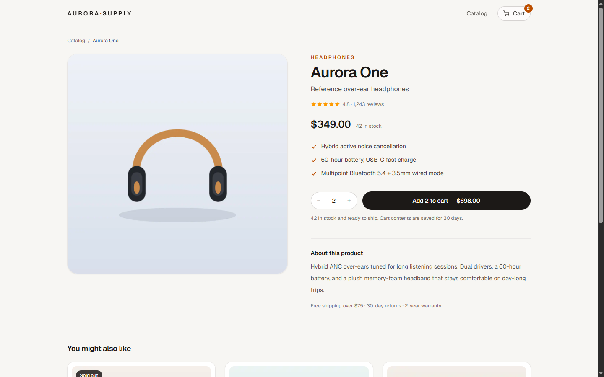
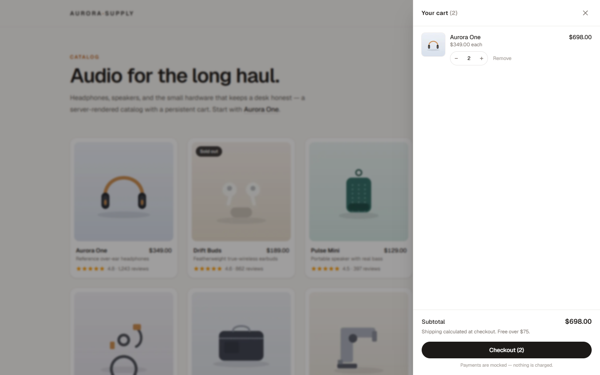

# Aurora Supply — Senior Fullstack Assessment (5+ Years)

A small e-commerce storefront built to the brief in [`README-5-YEARS-Plus.md`](./README-5-YEARS-Plus.md):
a product detail page with Next.js (App Router) and a shopping cart, focused on architecture,
performance and UX. **I built this in the ~1–2 hour budget: catalog + product page + cart API + UI,
nothing speculative.**

**Live flow:** `/` catalog grid → `/products/[id]` detail page → add to cart → cart slide-over
(persisted across reloads) → API-backed totals.

| | |
| --- | --- |
| Product detail page |  |
| Cart slide-over with persisted state |  |

## Quick start

```bash
npm install
npm run dev         # http://localhost:3000
npm run build       # verifies: typecheck, lint, static prerender of all routes
npm test            # 37 Vitest tests: cart rules + full route-handler contract matrix
npm run test:e2e    # 3 Playwright E2E specs against the production build
```

No database and no environment variables — the catalog is mock data (allowed per the brief), so
the app runs from a cold clone with just `npm install`.

## What's implemented

- **Catalog** (`/`) — server-rendered grid, all eight products.
- **Product detail page** (`/products/[id]`) — server component for data, client island for the
  add-to-cart form, loading skeleton (`loading.tsx`), route-level error boundary (`error.tsx`
  with retry), hard 404 for unknown slugs, per-product metadata (title/description/OpenGraph) and
  Product JSON-LD.
- **Cart** — add / update quantity / remove / view, persisted in an **httpOnly cookie** for 30
  days, with a slide-over drawer (qty steppers clamped to real stock, remove, subtotal, empty
  state, error banner).
- **API routes** — products (list + single) and cart (read + add + update + remove), all with
  typed JSON responses and explicit status codes (400/404/409).
- **Performance** — every page statically prerendered at build time; `next/image` with `priority`
  on the LCP image and responsive `sizes`; one font family via `next/font`; interactive JS
  islands only (the catalog, header markup, rating rows and page bodies ship as RSC payloads).
- **Tests** — 37 Vitest unit/integration tests on the cart rules + route handler contracts, and
  3 Playwright E2E specs over the production build (see "Testing" below).

## Architecture decisions (the ones worth defending)

**1. Static-first rendering, client islands only where interaction lives.**
The catalog and both PDPs are generated at build time (`generateStaticParams`) — the product set
is known, so pages render instantly without dynamic fan-out. Only three client components exist
(`AddToCart`, `CartBadge`, `CartDrawer`); everything
else sends zero JS. The scaffold ships with `cacheComponents: true`, and I chose to work with it
rather than around it.

**2. Cart persistence: httpOnly cookie, not localStorage.**
Three reasons:
- *Server authoritative.* The client can only **request** mutations. Snapshots are always
  recomputed server-side from the catalog — a tampered client cannot fabricate a subtotal, because
  prices and totals never round-trip through untrusted state.
- *Same persistence UX as localStorage* (survives reloads/tabs) but unreadable to XSS and needs no
  local schema migrations. The payload is just `{productId, quantity}` pairs — trivially small.
- *No hydration tricks.* A localStorage cart needs `skipHydration` handling to avoid an SSR
  mismatch flash; the cookie cart lets client state hydrate from `GET /api/cart` after mount.
  SSR-rendering the cart badge would have forced **every** page dynamic for one number, so the
  badge hydrates client-side instead — a deliberate trade-off (badge content pops in one paint
  after hydration; pages stay static).

**3. Money is integer cents, never floats.**
`price`/`unitPrice`/`lineTotal`/`subtotal` are integers; `formatPrice` does `Intl.NumberFormat`
formatting at the edge of the system. No `0.1 + 0.2` surprises anywhere in the totals path.

**4. One thin client store (`zustand`), holding only server snapshots + UI state.**
The store never computes totals — it stores whatever `GET /api/cart` / a mutation returned, plus
drawer visibility, per-line busy flags and errors. A `useReducer` context would also work, but a
framework-agnostic store keeps cart logic out of the render tree and out of any page's subtree.

**5. Deterministic, in-repo product art.**
The brief asks for optimized images. Rather than pointing at a remote stock-photo host (network
dependency during review + remotePatterns config) I authored eight flat-vector product scenes as
SVG and rasterize them to `public/products/*.jpg` with sharp at authoring time
(`node scripts/generate-product-images.mjs`). `next/image` then does real optimization work
(content-hashed URLs, responsive `srcset`, lazy loading, LCP `priority`). Vector-first art also
matches the flat storefront look without licensing concerns.

## API reference

Errors use `{ error, detail }`. All mutations respond with the current cart snapshot.

| Method | Path | Notes |
| --- | --- | --- |
| `GET` | `/api/products` | `?category=` headphones/speakers/accessories, `?sort=` featured/price-asc/price-desc/rating |
| `GET` | `/api/products/:id` | 404 for unknown id |
| `GET` | `/api/cart` | Always 200 — "no cookie" is a valid empty cart. `no-store` |
| `POST` | `/api/cart/items` | `{productId, quantity?}` (default 1) → 201. 404 unknown product, 409 fully out of stock, 400 bad quantity |
| `PATCH` | `/api/cart/items/:id` | `{quantity}` (0 removes the line) → 200. 404 not-in-cart, 400 above stock limit |
| `DELETE` | `/api/cart/items/:id` | → 200 with post-removal snapshot. 404 unknown/not-in-cart |

Quantity behavior (documented choice): on **add**, requested quantities are clamped to available
stock rather than rejected — the server has the final word and reflects reality; on **update**,
quantities above the stock limit are rejected with 400, since a stale UI shouldn't silently lower
your intent.

Verified locally (each of these was run against the dev server while building):

```bash
$ curl -s localhost:3000/api/products/aurora-one | jq .product.id
"aurora-one"

$ curl -s -w "%{http_code}" -X POST localhost:3000/api/cart/items \
    -H 'Content-Type: application/json' -d '{"productId":"aurora-one","quantity":2}'
{"items":[...],"itemCount":2,"subtotal":69800,"currency":"USD"}201

$ curl -s -w "%{http_code}" -X PATCH localhost:3000/api/cart/items/aurora-one \
    -H 'Content-Type: application/json' -d '{"quantity":0}'   # PATCH 0 == remove
{"items":[],"itemCount":0,...}200

$ curl -s -w "%{http_code}" -X POST localhost:3000/api/cart/items \
    -H 'Content-Type: application/json' -d '{"productId":"ghost","quantity":1}'
404 {"error":"product_not_found","detail":"..."}
```

Edge cases covered: malformed JSON body (400), non-integer/zero/negative/over-99 quantity (400),
unknown product (404), updating/removing a product not in the cart (404), out-of-stock product
add (409), same-product add merging into one line, quantity clamped to stock, dirty/malformed
cookie tolerated as an empty cart and repaired on the next mutation, per-line `busy` handling so
double clicks can't corrupt state, sold-out PDP branch (button never lies), Esc/overlay close and
scroll-lock on the drawer.

## Testing

Three layers, all green in this repo:

- **Vitest — cart domain rules** (`tests/cart.test.ts`): every sanitize/merge/clamp behavior of
  `lib/cart` one way and the other — over-cap quantities clamped to the binding limit (stock or
  the 99-unit line cap), unknown SKUs dropped, garbage cookies tolerated, cents-exact totals, and
  the add-vs-update quantity validation contracts. Cookie flags (httpOnly/SameSite/Max-Age,
  Secure-in-prod) pinned too.
- **Vitest — route handler contracts** (`tests/api-cart.test.ts`): the full cart API matrix —
  200/201/400/404/409, repeat-adds merging into one line, merged adds capped at the per-line
  limit, dirty-cookie repair, `no-store` — with `next/headers` mocked to an in-memory cookie
  store so the handlers run as real code without a server.
- **Playwright — E2E** (`tests/e2e/cart.spec.ts`, run against the production build via the
  `webServer` config): add to cart → drawer opens with correct totals → **full page reload →
  cart persists through the cookie**; sold-out product can't be added; unknown slug answers a
  real HTTP 404.

One platform subtlety worth naming: with `cacheComponents` (Partial Prerendering), a streamed
`notFound()` keeps HTTP 200 — the shell is already on the wire — so unknown product slugs are
answered by `proxy.ts` (edge middleware), which validates the slug against the catalog before
the page streams and returns a genuine 404. Verified by the E2E suite.

## Assumptions

- **USD only.** One currency constant; a real store adds FX + locale-formatted prices.
- **No checkout.** The brief scopes to product page + cart, so Checkout is a labeled demo stub —
  building payments "extra" would be noise, and I'd rather spend the effort on the acceptance
  criteria.
- **Per-visitor cookie cart.** Guest carts only; no login. A signed-in session would link the
  snapshot to a user id after one merge-on-login step.
- **Static catalog.** No DB. `lib/catalog` is the single source of truth for both RSC and API
  routes. Swapping it for Postgres/Drizzle would not touch components.

## With more time I would reach for

- A real data layer (Postgres + a typed query layer) with `revalidateTag`-based cache
  invalidation so product pages stay static until an actual catalog change.
- Cart "intent" merge for logged-in users, and `Sec-Fetch`/bot-friendly API responses.
- Lighthouse budget in CI (e.g. `@lhci/cli`) to pin the performance story to a number.

## Stack

Next.js 16 (App Router, `cacheComponents`), React 19, TypeScript strict, Tailwind CSS 4,
zustand 5, next/image + next/font. Lint and typecheck pass clean (`npm run lint`,
`tsc --noEmit` via `next build`).
